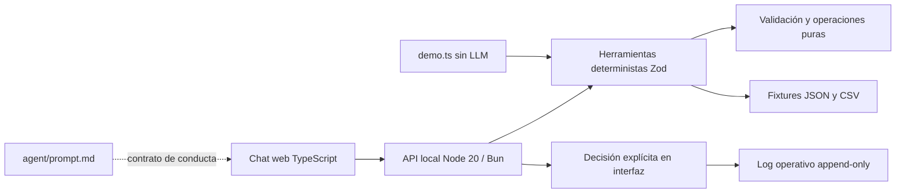

# Solución: agente conversacional de contratos

## Alcance y datos

Este repositorio llegó sin código ni fixtures del reto: solo contenía un `README.md`. Para que la demo sea ejecutable sin simular que procesó información real, el proyecto incorpora fixtures pequeños y **sintéticos**, rotulados como tales. No representan contratos, proveedores ni personas reales. Se deben sustituir únicamente por un conjunto autorizado y validado por el dueño de datos.

El maestro ilustrativo tiene fecha de corte **30-may-2026**. Las alertas consideran los 30 días siguientes a esa fecha, no el reloj actual. El CSV es fuente histórica inmutable. Una aprobación humana escribe un evento append-only en `fixtures/reto-02/aprobados.jsonl`; lecturas posteriores aplican esos eventos como overlay sin editar el snapshot original. Este archivo aparece al aprobar por primera vez y no debe versionarse con datos de producción.

## Arquitectura Clean

- **Presentación:** cliente Vite en TypeScript; los mensajes del usuario se convierten en comandos explícitos y las llamadas/resultados se muestran en el registro lateral.
- **Aplicación:** API HTTP local coordina validación, herramientas y estado temporal de propuestas.
- **Dominio:** schemas Zod y funciones deterministas de consulta, búsqueda, vencimiento y validación de cambios.
- **Infraestructura:** lectura de JSON/CSV y persistencia de eventos aprobados; el CSV base no se muta.
- `agent/prompt.md` es especificación para una futura integración LLM. No se carga ni ejecuta en esta demo, y no existe API de modelo.

## Ciclo de interacción

1. Persona escribe un comando compatible: `/buscar texto`, `/contrato ID`, `/vencen` o `/proponer ID campo valor`.
2. La UI manda una solicitud tipada al API; Zod valida la forma y el núcleo carga y valida ambas fuentes.
3. Consultas deterministas producen resultados que se muestran en chat y en el registro auditable de herramientas.
4. Para cambios, el sistema construye una propuesta no persistida y presenta valor actual, solicitado y dos decisiones. La API solo conserva la propuesta en memoria.
5. **Aprobar escritura** registra el evento en el log. **Rechazar** lo descarta sin persistir. Ninguna otra ruta API escribe.
6. La UI muestra alertas relativas al corte del dataset; no son una notificación programada en tiempo real.

La demo de consola procesa `msg-001` a `msg-006` en orden, aplica reglas explícitas de clasificación y confianza por campo, y no ejecuta escrituras ni usa LLM.

## Decisiones, límites y mejoras

- Se eligió una API HTTP pequeña de Node en vez de un framework para minimizar componentes y facilitar la reproducción con Node 20+ o Bun.
- El demo usa lenguaje de comandos y reglas fijas, no comprensión abierta de correo. La clasificación por reglas se limita a ilustrar el ciclo; los casos ambiguos solicitan aclaración.
- Propuestas pendientes viven en memoria y se pierden al reiniciar. Para varios usuarios o producción habría que añadir identidad, permisos, almacenamiento transaccional, auditoría protegida, concurrencia, cifrado, backups, observabilidad, retención y pruebas de seguridad.
- El servidor escucha en loopback y no tiene autenticación. No desplegar públicamente ni cargar datos reales sin implementar esos controles y una evaluación formal.
- Los datos y las alertas son ficticios; no hay credenciales de servicios, despliegue o URL pública configurados.

## TCO orientativo

La demo local no tiene consumo de inferencia ni servicio externo; el costo de ejecución es el equipo local, desarrollo y mantenimiento. Para producción, el TCO depende de volumen de documentos/correos, almacenamiento y retención, autenticación/SSO, cómputo, monitoreo, backups, soporte, revisiones legales y eventual proveedor de LLM. No hay un precio responsable que estimar sin esos volúmenes y requisitos. La primera prioridad de costo y riesgo es gobernanza, no inferencia: asignar dueño de datos, permisos, retención y revisión humana.

## Regla de gobierno de datos

**El sistema no inventa ni modifica la verdad contractual:** fuente y fecha de corte deben estar aprobadas por el dueño de datos; cada extracción muestra origen y confianza; una confianza nunca autoriza una acción; toda escritura requiere aprobación humana explícita y queda auditada; el histórico se conserva; los casos ambiguos o sensibles se escalan a revisión. No incorporar datos reales al repositorio, demo o servicios de terceros sin autorización, controles y política de retención aprobados.
